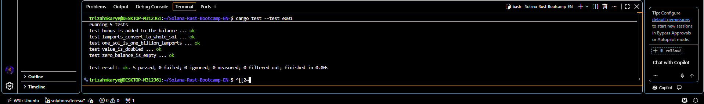

# ex01 — Variables and Types
**Name**: Teresia Mkarie

## Tasks Done
- ex01. 
I finished the exercise1 and here is what i did as per what was asked of me.I Opened the `src/ex01.rs` and replaced each `todo!()` with the required answers.

## Done when
I was done when: 
- 1.**`cargo test --test ex01` showed `5 passed`.**
  

- 2.**Explain the difference between `let`, `let mut`, and shadowing.** 
-`let`:- It lets one create a variable that is not changeable(**an immutable variable**) 
-`let mut`:-  It allows a variable to change;it allows mutability of a variable.FOR EXAMPLE; The same variable can have its value changed.
-`Shadowing`:- It creates a new variable with the same name.It can even have a different type unlike `let mut` cannot.

- 3.**Explain why the balance is a `u64` and not an `f64`.** 
`u64` is an unsigned 64-bit integer that  is used for monetary calculations which brings reality when calculating;One's balance cannot be below  zero.`u` means unsigned so it cannot be negative unlike `f64` stores numbers in binary where many decimals cannot be  represented exactly. 