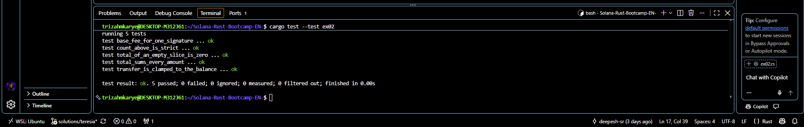

# ex02 — Functions and Control Flow
**Name**: Teresia Mkarie

## Tasks Done
- ex02. 
I finished the exercise2 and here is what i did as per what was asked of me.I Opened the `src/ex02.rs` and replaced each `todo!()` with the required answers.

## Done when
I was done when: 
- 1.**`cargo test --test ex02` showed `5 passed`.**
  

- 2.**Explain why the last expression has no semicolon.** 
The last expression without a semicolon is the return value because  a function body is a block and adding the semicolon will break  it. 

- 3.**You can explain what `&[u64]` means in the signature.** 

