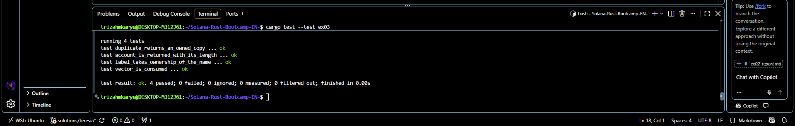

# ex03 — Ownership
**Name**: Teresia Mkarie

## Done when
I was done when: 
- 1.**`cargo test --test ex03` showed `4 passed`.**
  

- 2.**Explain why `let b = a;` invalidates `a` for a `String`.** 
`let b = a;` the string moves frrom a to b since only one string can own 1 item at a time thus `a` becomes invalid.

- 3.**Explain when `.clone()` is honest and when it is a workaround.** 
A `.clone()` is used when I need two separate copies of the data. Cloning is allowed when you genuinely need two owned values thus making cloning honest. 
It is a workaround when you added just to make a `moved value` error go away.
